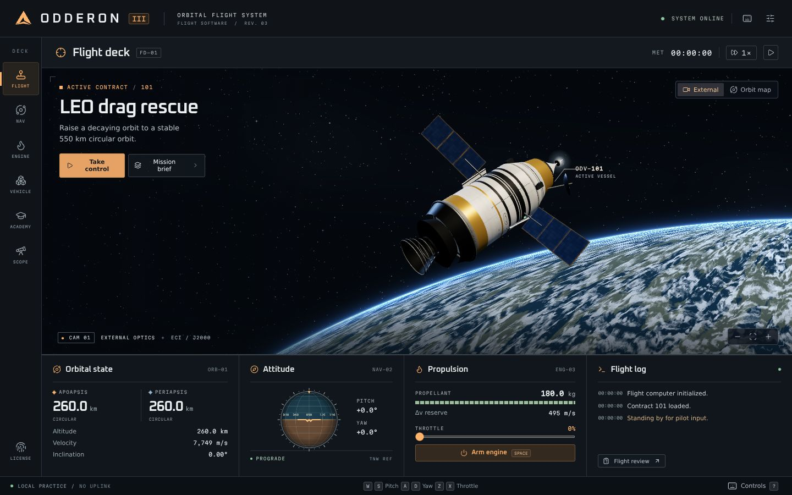

# Odderon III · Flight deck

A browser-first orbital flight game built **on v1**, with a hands-on cockpit inspired by v2. You point the vehicle, open the throttle and cut the engine. The ship does not fly to a number you entered. Keep a prediction if you want one, then compare the result with what you expected.



## Play

From the repository root, with Node 22.12+ and npm:

```sh
npm ci
npm run dev
```

No Rust installation, account, API key or backend is needed to play. `runtime/odd_view.wasm` is a checked-in bootstrap build. `npm run build` stages the same local instruments, fonts, notices and WASM into `dist/`. Use `npm run preview` or serve that directory from any static HTTP(S) origin. **Serve it rather than double-clicking `index.html`**: modules, workers, and WASM need an origin. There are no CDNs or runtime dependencies on external hosts.

### First rescue

1. Start on contract **101**, already in a 260 km orbit. Open **Mission brief** to change contracts, or record an optional preflight prediction. A prediction never issues a command.
2. Press **Space** to arm and take control. Hold **Z** to increase throttle. Watch apoapsis rise. Press **Space** again to safe and cut to zero. **W/S** pitch, **A/D** yaw, **Q/E** roll. The throttle slider and touch attitude keys work without a physical keyboard.
3. Use **Orbit map** and the estimated apsis times to coast toward the high point. **.** cycles coast warp; arming or steering drops back to 1×. Burn again near apoapsis to bring up periapsis. The cadet objective is a **550 km circular orbit within three hours**. Osculating elements can drift between burns; a predicted high point is not a guaranteed arrival altitude.
4. **Flight review** pauses the simulation. Compare prediction and measurement, inspect objective attainment, export a pilot-signed manual tape, or file the last flight on this device. At most one filed manual tape is retained locally; export the ones you want to keep. **P** or the play switch resumes an unfinished flight. Losing focus or opening an instrument pauses the cockpit; it does not silently burn fuel behind a dialog.

The other contracts are **102**, an inclined, sun-synchronous orbit with a five-day nodal drift objective, and **103**, a cryogenic cislunar tug requiring perigee kicks. All start in orbit. No surface launch or lunar-capture optimizer is implied.

## Repository layout

Odderon III runs from the root of this repository. [`odderon-v1/`](odderon-v1/) contains the original game and the shared Rust engine and instrument sources. [`odderon-v2/`](odderon-v2/) contains the earlier cockpit prototype.

## Flight and engineering are different jobs

| Station | What is actually connected |
| --- | --- |
| **Flight** | Manual rate-command attitude, finite thrust, fuel depletion, drag/J2/SRP/third-body forces, live cryogenic checkpoints, fitted mass, impact and mission window. Exterior camera and navball are generated in JavaScript. |
| **Nav** | The real v1 planner, multi-node prediction, Physics Lens, causal warnings, numerical perigee splitting, patched lunar encounter and B-plane practice tools. **Fly fitted stage** transfers the blueprint and any filled prediction. The orbit map can show its reference track alongside the measured trail; nodes never operate the pilot's throttle. |
| **Engine / Vehicle** | The solved engine CAD/Schlieren lab, engine fitting, tanks, insulation, cooling, electrical allocation and Chief-AI delegation. Transfer starts a **new** manually controlled flight; a flying ship cannot be refitted mid-burn. |
| **Academy** | The v1 seven-lesson instrument curriculum, placement diagnostic and opt-in progress/playtest controls. These teach the engineering benches, not a rebranded scripted cockpit tutorial. |
| **Scope** | The interactive DE440s Earth–Moon observatory, date controls, numerical study and display layers. |
| **Prediction / planned-flight debrief** | The existing engineering experiment, including locked predictions, causal attribution and dossiers. Executing that experiment simulates its **plan**, separately from the manual cockpit. |
| **License / recorder** | Local Ed25519 identity, v1 signed recorder replay and dossier export. Manual control tapes have their own signed format and independent local replay. They are **not** v1 node-list FDRs. |

### Explicitly postponed: ranked Astro-Elo

**V3 includes no Cloudflare, hosted authority, first-attempt commit service, server-signed ranked receipts, public replay service or ranked leaderboard. Server-authoritative Astro-Elo is postponed.** Local verification establishes that the inputs reproduce a result and the pilot signed it. It cannot establish that a player did not retry or reset local storage. No local result awards official Elo. See [runtime and trust boundaries](docs/architecture.md).

## CI is the Rust compiler

[Odderon III browser game](.github/workflows/odderon-v3.yml) builds `odd-view --features cockpit` from the locked **v1** workspace for `wasm32-unknown-unknown`, runs native and emitted-WASM tests, builds the web game, and runs browser acceptance against that build. It uploads **`odderon-v3-browser`** (serve as-is) and **`odderon-v3-rust-runtime`** (the WASM alone). The job is read-only; no deploy, branch write or Cloudflare credentials. For a Rust change use that run's artifact, not an older checkout's binary. To refresh the bootstrap, copy the runtime artifact to `runtime/odd_view.wasm` and run the acceptance tests.

Optional local rebuild:

```sh
cd odderon-v1
rustup target add wasm32-unknown-unknown
cargo build --locked --release -p odd-view --features cockpit --target wasm32-unknown-unknown
cp target/wasm32-unknown-unknown/release/odd_view.wasm ../runtime/
cd ..
npm test                       # signed replay, fitted hardware and a complete manual rescue
npm run build
npx playwright install chromium
npm run test:browser           # cockpit, stations, manual filing and tamper rejection
```

## Desktop later, browser first

There is a thin optional Electron shell for the **same `dist/`**, using a local application origin rather than a remote website. On a desktop with a graphical session, run `npm ci --prefix desktop` once, then `npm run desktop`. Electron is not part of a browser install. No Steamworks SDK, Steam login, depot, achievement service, native installer or store submission is included. Desktop packaging, platform-specific QA and Steam publication remain future work.

Local acceptance evidence and remaining platform gaps: [browser distribution verification](docs/verification.md).
