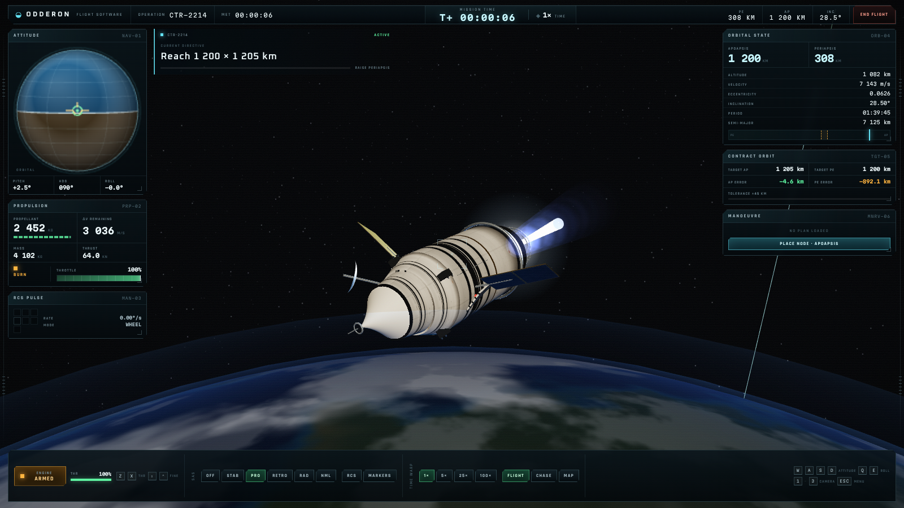
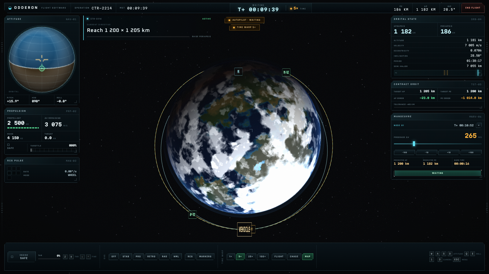
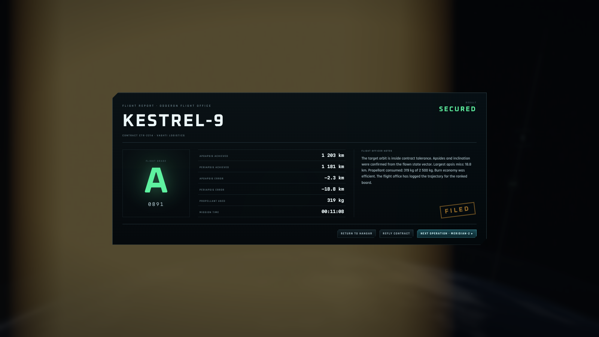

# Odderon 2

A browser-and-desktop orbital flight game. You fly a spent upper stage with a
single engine, a limited tank and a contract that has to be met inside a launch
window. The presentation is a cockpit: a lit planet below, a lit spacecraft in
front of you, and a dense instrument HUD docked to the edges of the screen.



This is the second pass. The physics, ephemeris and contract data come from the
`odderon-v1` tree; the interface was rebuilt from scratch so it reads as a game
rather than a document.

## Run it

```bash
npm install
npm run dev        # http://localhost:5173 — hot reload
npm run build      # tsc + vite → dist/ (classic IIFE bundle, works from file://)
npm run preview    # serve the production build
npm run desktop    # build, then run inside the Electron shell
npm run package:linux | package:win | package:mac
```

`dist/index.html` is fully offline and loads from a `file://` URL, which is what
the Electron shell and a Steam depot need. There is no runtime dependency, no
network call, no analytics.

The visual harness (`npm run visual`) drives the game in headless Chromium and
writes screenshots to `tools/visual/.shots/`. It needs `playwright-core` and
`@sparticuz/chromium`; see `tools/visual/package.json`.

## Loop

1. **Operation brief** — pick one of three contracts on the launch screen.
2. **Flight** — place a manoeuvre node at an apsis, align, burn, trim.
3. **Flight report** — grade, score, propellant used, apsis errors, filed stamp.

The Kestrel-9 contract (CTR-2214) raises a 186 × 1 182 km orbit to a circular
1 200 km slot. One targeted burn at apoapsis is enough; the autopilot will fly
it for you if you let it.

### Manoeuvre planning

`PLACE NODE · APOAPSIS` solves the vis-viva burn that moves the apsis that needs
moving and puts the node on it. `ALIGN & EXECUTE` hands the burn to the flight
computer: SAS tracks the node direction, the burn is centred on the node time,
and the engine is cut on the measured apsides rather than on a stopwatch, which
matters because a 265 m/s burn takes about 17 seconds and drifts.

The autopilot drops out of warp to 5× near the node and to 1× for alignment.
Warp is capped at 5× whenever the engine is lit.




## Controls

| | |
|---|---|
| `W` `A` `S` `D` | pitch / yaw |
| `Q` `E` | roll |
| `T` | cycle SAS (off, stability, prograde, retrograde, radial, normal) |
| `R` | RCS authority (3.2× wheel torque) |
| `SPACE` | arm / safe the engine |
| `Z` / `X` | throttle up / down (`SHIFT` for fine) |
| `,` / `.` | warp down / up |
| `1` `2` `3` | flight, chase, map camera |
| drag / wheel | orbit / zoom |
| `ESC` | pause |
| `F11` | fullscreen |

## Flight model

- Two-body gravity with an optional J2 term in the RK4 integrator.
- Coasts use an exact universal-variable Kepler solver, so time warp never
  accumulates error and a node 100 minutes away costs nothing.
- Burns integrate RK4 at ≤ 0.05 s per step.
- Attitude is a rigid body with reaction wheels (2 400 N·m, 0.55 rad/s limit)
  and a PD controller; RCS triples the available torque.
- Propellant, mass and Δv come from the rocket equation (Isp 340 s, 64 kN).
- Contract scoring: 62% apsis accuracy, 24% propellant reserve, 14% time in
  window. S ≥ 950, A ≥ 850, B ≥ 700, C ≥ 550.

Units are SI throughout the core; the renderer converts to kilometres, tonnes
and seconds for display.

## Rendering

Three.js, WebGL2, one vessel-centred scene. Earth is a custom shader globe
(warped fbm continents, hypsometric oceans, latitude/moisture biomes, two cloud
layers with shadows, ocean specular, city lights) plus two additive atmosphere
shells. The vehicle is procedural: hull texture, gold foil, solar wings,
radiators, RCS quads, plume with a hot core and shock diamonds, strobe and
engine light.

`logarithmicDepthBuffer` is on, so every custom `ShaderMaterial` must include
`<common>`, the log-depth chunks and the tone-mapping/colour-space chunks. The
depth range spans metres at the vessel and millions of metres at the planet.

## Layout

```
src/core      physics, orbits, contracts, vessel, scoring
src/render    renderer, Earth shader, ship, trajectory, textures, scene
src/ui         HUD, navball, screens, CSS, procedural audio
src/game      mode machine, autopilot, input, per-frame ticks
electron      desktop shell (fullscreen unless ODDERON_FULLSCREEN=0)
tools/visual  headless screenshot harness
```

## Known limits

- Two-body patched conic only: no perturbations beyond J2, no atmospheric drag
  on the flown orbit, no n-body.
- One vehicle, three contracts, no save games.
- Desktop packaging is configured but only the Linux AppImage target has been
  exercised in this environment.
